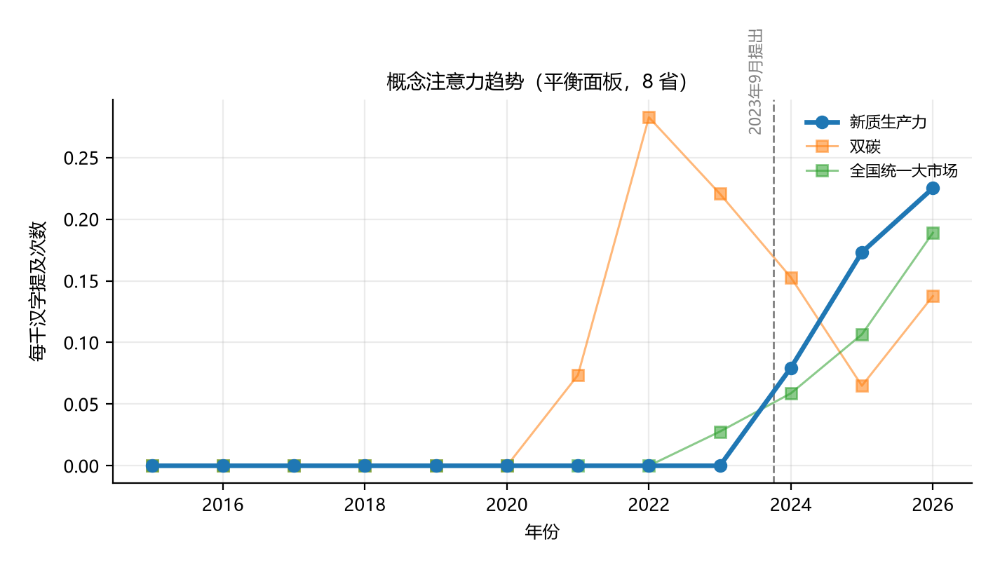
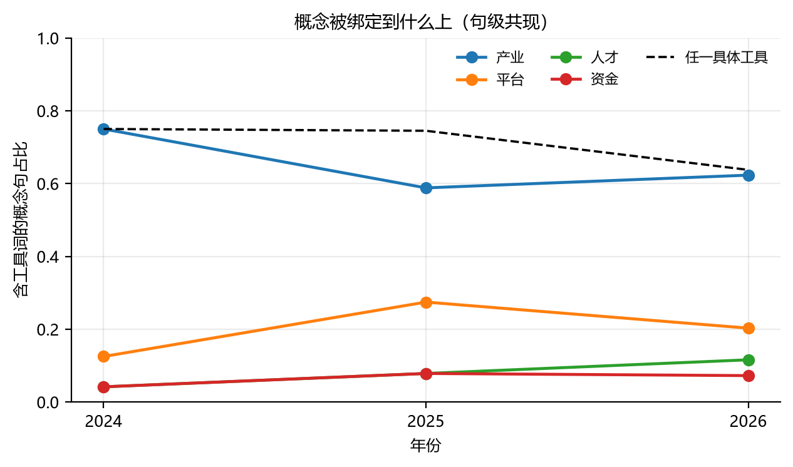
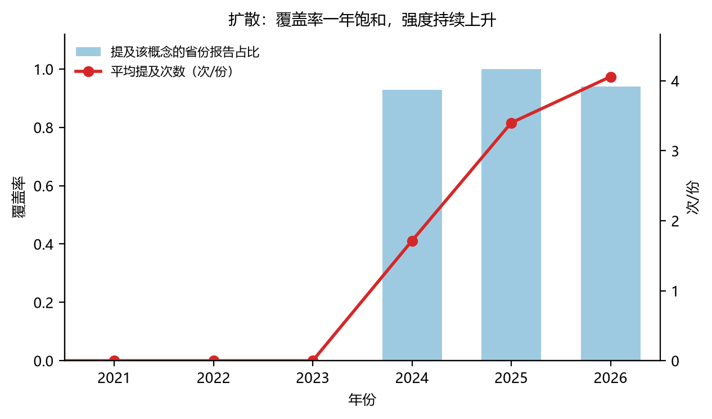

# gov-report-atlas

> 「新质生产力」在省级政府工作报告中的扩散与转译（2015—2026）

采集 14 个省级行政区 2015–2026 年的 **129 份政府工作报告**（约 247 万字、6.7 万句），
测量一个政策概念如何从中央文本进入地方文本，以及在地方文本里被绑定到什么政策工具上。

**数据不随仓库分发**：`data/manifest.csv` 记录每份文档的来源 URL 与 SHA256，
按清单即可重建语料。原始文本版权归各政府门户所有。

## 主要发现

| 发现 | 证据 |
|---|---|
| **扩散一年内饱和** | 2024 年 92% 的省份已提及，2025–2026 年达 100% |
| **强度翻了 2.5 倍** | 平均每份报告提及 1.69 → 3.08 → 4.21 次 |
| **转译结构位移** | 与「产业」共现率 0.73→0.61，与「人才」0.05→0.14 |
| **未见空心化** | 至少绑定一项具体政策工具的比例稳定在 0.63–0.73 |
| **注意力挤占** | 「双碳」份额由 2022 年 0.283 降至 2025 年 0.065 |





完整报告见 [`docs/report.md`](docs/report.md)，答辩准备见 [`docs/defense.md`](docs/defense.md)。

## 快速开始

```bash
pip install -e ".[dev]"
make test                       # 17 个用例，不联网
python scripts/build_manifest.py   # 重建清单（需联网）
make fetch                      # 下载
make parse                      # 解析
```

## 方法要点

- **注意力份额**：概念出现次数 ÷ 正文汉字数 × 1000。用汉字数而非词数，绕开中文分词误差，
  也避免报告篇幅差异（本文语料 7,181–47,107 字）造成的不可比。
- **转译测量**：句级共现——同一句话内是否同时出现概念与政策工具词（资金/人才/平台/产业/制度/数字）。
- **口径敏感性**：字符窗口法在 15 字与 40 字两种设置下结论相反，故弃用；句级口径无自由参数，
  两种口径的完整结果都保留在 `data/processed/` 供复核。
- **平衡面板**：各年可得省份数不同（2015 年 8 个，2026 年 14 个），趋势一律限定在 12 年齐全的 8 省上。

## 数据来源与合规

- 全部为政府门户**公开**发布的政府工作报告；
- 不模拟登录、不绕验证码、不采集个人信息；
- 限速 1–2 req/s，失败重试，遵守 robots；
- 仓库只放清单与衍生指标，不转发原文。

## 目录

```
config/     regions.yaml（样本框）、concepts.yaml（概念词典）、portals_seed.yaml
data/       manifest.csv（唯一事实来源）、regions.csv、processed/（指标表）
src/gra/    fetch / parse / attention
scripts/    probe_portals / build_manifest / translation / robustness / figures
docs/       report.md、concept_dict.md、qc_protocol.md、figs/
```

## 复现

```bash
python scripts/build_manifest.py   # 从省级栏目页重建清单
python -m gra.fetch                # 下载（限速、断点续传）
python -m gra.parse                # HTML/PDF -> 纯文本
python -m gra.attention            # 注意力面板
python scripts/translation.py      # 句级共现
python scripts/robustness.py       # 稳健性
python scripts/figures.py          # 三张图
```

## 已知局限

- **样本选择性**：14/31 个省级单位。广东、江苏、浙江、山东等 17 个省份的报告栏目由 JavaScript
  动态渲染，静态请求拿不到链接，故未纳入；缺失者多为经济大省，结论外推需谨慎。
- **三年观察窗**：概念 2023 年 9 月提出，扩散只有 2024–2026 三个年度可观测。
- **词表主观性**：概念与工具词表由作者设定，虽有敏感性检验，仍不能排除遗漏。
- **非因果**：本文为描述性计量，不构成因果推断。

## 许可

代码 MIT；衍生数据 CC-BY-4.0。
