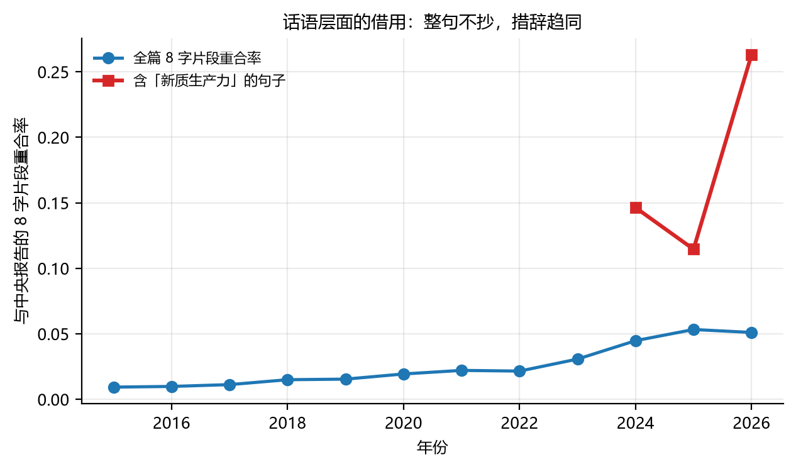

# gov-report-atlas

[](https://github.com/sdldw/gov-report-atlas/actions/workflows/ci.yml)

> 一个政策概念怎么走进地方文本：以「新质生产力」为例

2023 年 9 月提出的「新质生产力」，用**一年**就写进了几乎所有省级政府工作报告。
但它进去以后发生了什么？我们把 18 个省级行政区 2015–2026 年的 **150 份政府工作报告**
（334 万字符、7.7 万句）拆开来看，发现了一件有点反直觉的事：

> **地方的说法越来越像中央，做法却越来越不一样。**

---

## 一、数据从哪来

全部来自各省级政府门户**公开发布**的政府工作报告，无一处来自生成式模型。

| 项目 | 数值 |
|---|---|
| 省级行政区 | 18 个 |
| 政府工作报告 | **150 份**（2015–2026） |
| 总字符 | 3,337,211（其中汉字 2,846,637） |
| 句子 | 76,741 句 |
| 对照用中央报告 | 3 份（2024–2026 国务院政府工作报告） |

**每份文档都可逐条追溯**：`data/manifest.csv` 记录 `doc_id → 来源 URL → SHA256 → 字节数`。
原始文本不随仓库分发（版权归各门户），但按清单可完整重建语料。

## 二、爬到了多少：一条完整的漏斗

不是「上去就爬」，每一级都有产物留在仓库里：

| 阶段 | 结果 | 产物 |
|---|---|---|
| 1. 省级门户探针 | 31 省中 **28 个可达** | `data/probe/portals.csv` |
| 2. 找报告栏目 | **21 个**找到栏目页 | 同上 |
| 3. 提取多年度归档 | **18 个**省有可用归档 | `data/manifest.csv` |
| 4. 下载并解析 | **150 份**通过正文校验 | `data/interim/text/` |

前三级用静态请求；失败的门户另试过搜索引擎与无头浏览器（`scripts/render_portals.py`），
虽能取到栏目地址，但文章路径多已失效，见第六节。

## 三、四个值得看的发现

### 1. 扩散不是「慢慢传开」，而是一年铺满


2024 年的报告里就有 **93%** 的省份提到了它（概念提出仅四个月），2025 年达到 100%。
但覆盖率很快就饱和了，真正在变的是**强度**：平均每份报告提及 **1.71 → 3.40 → 4.06** 次。

### 2. 它绑定的东西在换挡


与「产业」一起出现的比例从 0.75 降到 0.62，与「人才」的从 0.04 升到 0.12，与「平台」的 2025 年冲到 0.27。
但**至少绑定一项具体政策工具**的比例三年稳定在 0.64–0.75——**没有变空**。

### 3. 说法趋同，做法分化



和中央报告逐句比对：**整句复制率不足 0.2%**，地方没有照搬。
但含「新质生产力」的句子，其 8 字片段与中央文本的重合率**从 14.6% 升到 26.3%**，
是全篇平均水平的三到五倍。

换句话说：**地方在借用中央的措辞，但不用中央的句子。**

### 4. 注意力是零和的


同一个平衡面板里，新质生产力从 0 起跳的同时，「双碳」从 2022 年的 0.283 掉到 2025 年的 0.065。
报告篇幅没变，进来的东西必然挤走别的东西。

## 四、分析流程

```
探针 (probe_portals)  →  清单 (build_manifest)  →  下载 (gra.fetch)
        →  解析 (gra.parse)  →  指标 (gra.attention / translation / copyrate)
        →  图 (figures)
```

三个关键设计：

- **分母用汉字数**，不用词数——绕开分词误差，也消除篇幅差异（本语料 7,181–47,107 字）
- **转译用句级共现**，不用字符窗口——窗口从 15 字调到 40 字，结论会翻转（见 `docs/report.md` 3.3）
- **趋势用平衡面板**——各年省份数不同（2015 年 8 个，2026 年 14 个），只用 12 年齐全的 8 省算趋势

## 五、怎么确认这些数据是真的

```bash
python scripts/verify_corpus.py
```

```
provinces=18 documents=150 verified=150 chars=3,337,211
```

它逐份检查：文件存在、SHA256 与清单一致、正文长度合理。要看逐条台账：

```bash
python scripts/verify_corpus.py --csv > corpus.csv
```

每一行是 `doc_id, 省份, 年份, 来源 URL, SHA256 前 12 位, 状态, 字符数`——
随便挑一行，把 URL 贴进浏览器，就能和仓库里的文件对上。

## 六、局限：为什么只有 18 个省

- **13 个省级门户的报告栏目是 JavaScript 渲染的**，静态请求只拿到空壳。我们试过无头浏览器，
  能取到栏目地址和年份链接，但文章路径多已失效（返回 404），未能在课程周期内补齐。
- 缺失者包括江苏、山东、江西等省份，结论外推需谨慎。
- 概念 2023 年 9 月提出，扩散只有 2024–2026 三个年度可观测。
- 概念与工具词表由作者设定，虽做了敏感性检验，仍不能排除遗漏。
- 本文是描述性计量，**不构成因果推断**。

## 七、快速开始

```bash
pip install -e ".[dev]"
make test                        # 19 个用例，不联网
python scripts/verify_corpus.py  # 核验语料
python scripts/figures.py        # 重画四张图
```

从零重建（需联网）：

```bash
python scripts/build_manifest.py   # 重建清单
python -m gra.fetch                # 下载
python -m gra.parse                # 解析
python -m gra.attention            # 注意力面板
python scripts/translation.py      # 句级共现
python scripts/copyrate.py         # 与中央报告的复制率
python scripts/figures.py          # 四张图
```

## 八、目录

```
config/     regions.yaml（样本框）、concepts.yaml（概念词典）、portals_seed.yaml
data/       manifest.csv（唯一事实来源）、processed/（指标表）、probe/（探测结果）
src/gra/    fetch / parse / attention
scripts/    probe / build_manifest / verify_corpus / translation / copyrate / figures
docs/       report.md（完整分析）、defense.md、figs/
```

## 数据合规

- 全部为政府门户**公开**发布的政府工作报告；
- 不模拟登录、不绕验证码、不采集个人信息；
- 限速 1–2 req/s，失败重试；
- 仓库只放清单与衍生指标，不转发原文。

完整分析见 [`docs/report.md`](docs/report.md)。代码 MIT；衍生数据 CC-BY-4.0。
