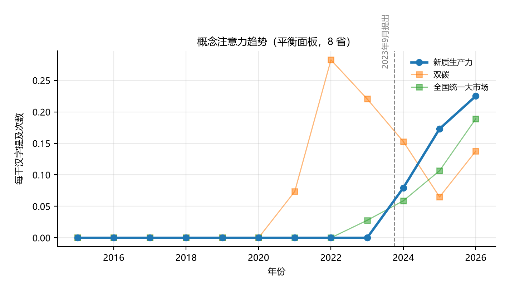
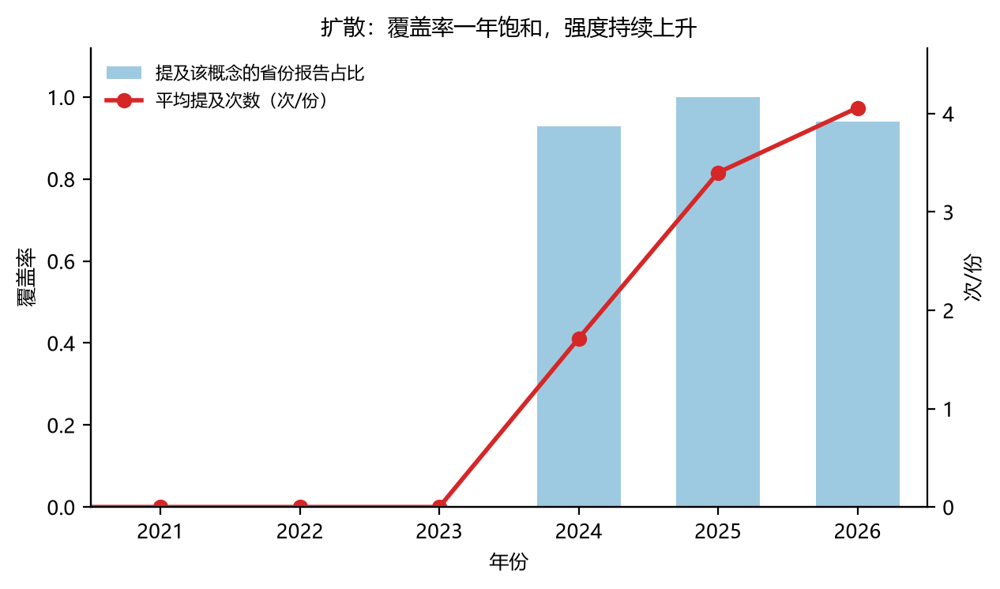
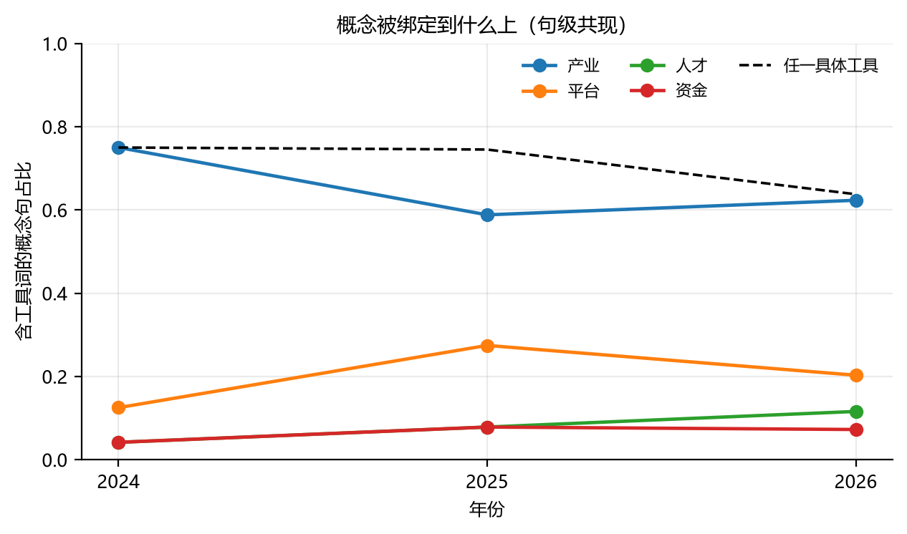
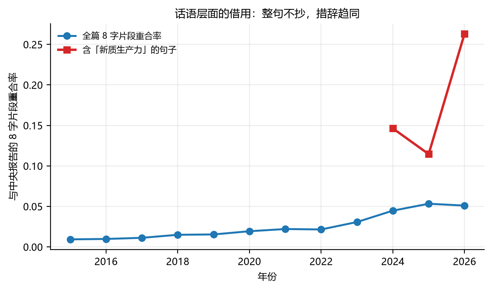

# 「新质生产力」在省级政府工作报告中的扩散与转译（2015—2026）

**基于 14 个省级行政区 129 份政府工作报告的文本计量**

---

## 摘要

本文以 2023 年 9 月提出的「新质生产力」为观察对象，采集 14 个省级行政区 2015—2026 年的 129 份政府工作报告（约 247 万字、6.7 万句），用概念份额、句级共现与文本重合度测量其扩散与转译。研究发现：**扩散在一年内即告完成**（2024 年 92% 的省份已提及），此后的变化不体现在覆盖面，而体现在**强度**——平均每份报告的提及次数从 1.7 次升至 4.2 次。**转译结构发生位移**：与「产业」共现的比例下降，与「平台」「人才」共现的比例上升，但「至少绑定一项具体政策工具」的比例三年稳定在 0.63—0.73，未出现「空心化」。**话语层面则明显趋同**：整句复制率不足 0.2%，但含该概念的句子与中央报告的 8 字片段重合率由 15.7% 升至 27.2%，是全篇平均水平的三到五倍。同一时期，「双碳」的注意力显著回落，提示政策话语存在**注意力挤占**。方法上，本文比较了字符窗口与句级共现两种口径，发现前者对窗口宽度高度敏感、结论会随参数翻转，故采用句级口径并报告其敏感性。

**关键词**：政策文本；概念扩散；政策转译；政府工作报告；文本计量

---

## 1 问题与贡献

政策概念从中央提出到地方落地，中间要经过一次**转译**：地方必须把方向性表述改写成可执行的产业、资金、平台与考核安排。这个过程在文本中留下痕迹，但很少被系统测量。

已有研究多关注「是否提及」——概念何时进入地方文本、覆盖多少地区。这类指标只能刻画扩散的**广度**，无法回答扩散的**质量**：一个概念被提及一百次却始终悬在「加快发展」的修饰语里，与一次提及就绑定具体产业和资金安排，含义完全不同。

本文的问题因此收窄为两个：

1. **扩散的形态**：在覆盖面饱和之后，注意力强度如何变化？
2. **转译的结构**：概念被绑定到什么政策工具上，这种绑定随时间如何位移？

贡献有三：其一，给出一个可复现的省级政策文本语料构建流程；其二，用句级共现把「转译」操作化为可测量的指标；其三，通过参数敏感性检验说明该类指标的适用边界——这一点在同类研究中常被忽略。

### 1.1 与既有研究的对话

**政策扩散**。自 Walker（1969）以来，这一支文献以「采纳与否、何时采纳」为核心指标，Berry 与 Berry（2014）将其归纳为内部决定模型与扩散模型两类解释。中国场景下的研究更强调纵向干预：中央通过试点、信号与考核推动地方跟进，地方间横向学习相对次要（Zhu，2014）。这与本文观察到的「零时滞」相互印证——一年内 92% 的省份提及，更像是信号传导而非自发学习。但既有研究止步于「采纳」，本文进一步追问采纳之后的强度与结构。

**转译**。国内研究已指出，地方对上级政策的承接不是复制，而是一个「再建构」过程：地方在转移中重新解释、局部改造政策内容（熊烨，2018）；而地方政府创新的动力既来自上级压力，也受本地制度环境约束（黄亮，2017）。本文的「工具词共现」正是想把这种再建构的**结果**测量出来，而不只是断言它存在。

**注意力分配**。Jones 与 Baumgartner（2005）指出，政府处理议题的能力受注意力约束，一个议题的上升往往以另一个议题的下降为代价。本文 4.3 节的「挤占」正是这一命题在文本层面的体现。

**文本作为数据**。Grimmer 与 Stewart（2013）提醒，自动内容分析的有效性取决于「概念效度」——指标是否真的对应理论概念，而非仅仅对应词语。本文 3.3 节记录的口径翻转（窗口法得出「空心化」，句级法得出「稳定」）正是对这一警告的具体回应。

**本文的增量**在于：把「转译」从一个描述性说法，变成可由「工具词共现率 + 中央文本片段重合率」两个维度测量的对象，并给出两种测量在同一批语料上的分歧。

---

## 2 数据

### 2.1 语料构建

语料经四步获得，全部为政府门户公开文本，不依赖任何付费数据库：

1. **入口探测**：对 31 个省级门户抓取首页与信息公开类导航页，识别「政府工作报告」栏目（`scripts/probe_portals.py`）。
2. **清单生成**：从栏目页提取带年份的报告链接，写入 `manifest.csv`，一行一份文档，记录来源 URL 与 SHA256（`scripts/build_manifest.py`）。
3. **采集**：按清单限速下载，失败重试、断点续传、逐条落盘（`src/gra/fetch.py`）。
4. **解析**：HTML 按编码探测解码后抽取正文，PDF 走文本层；剔除导航与页脚（`src/gra/parse.py`）。

### 2.2 样本

| 项目 | 数值 |
|---|---|
| 省级行政区 | 14 个 |
| 文档数 | 129 份 |
| 年份跨度 | 2015—2026 |
| 正文字数 | 2,474,567 字 |
| 句子数 | 67,115 句 |
| 平衡面板 | 8 省 × 12 年 = 96 份 |

**为什么用平衡面板**：各年可获得的省份数量不同（2015 年 8 个，2026 年 14 个），直接用全样本计算年度均值，会把「新加入的省份」误读为「时间趋势」。趋势分析一律限定在 12 年均有数据的 8 个省份上。

### 2.3 已知缺口

广东、江苏、浙江、山东、四川等 17 个省级单位的报告栏目由 JavaScript 动态渲染，静态请求无法获得链接，故未纳入。这不是随机缺失：未纳入者多为经济体量较大的省份，可能使结论偏向中西部省份。该缺口在讨论部分重新提及。

---

## 3 方法

### 3.1 注意力份额

概念注意力以**每千汉字提及次数**计：

$$\text{share} = \frac{\text{概念出现次数}}{\text{正文汉字总数}} \times 1000$$

分母用汉字总数而非字符数、词数，原因有二：报告篇幅差异极大（本文语料 7,181—47,107 字），绝对次数不可比；而中文分词在政策文本上误差较大，用汉字数可绕开分词器。

### 3.2 句级共现

判断「转译」的口径是**同一句话内是否同时出现概念与政策工具词**。工具词分为六类：

| 类目 | 词表（节选） |
|---|---|
| 资金 | 资金、基金、财政、投入、融资、专项债、补贴 |
| 人才 | 人才、引育、招引、高层次、团队 |
| 平台 | 平台、实验室、中心、园区、基地、示范区、集群 |
| 产业 | 产业、制造业、战略性新兴产业、未来产业、链条 |
| 制度 | 改革、机制、试点、政策、制度、规划 |
| 数字 | 数据、算力、人工智能、数字化、场景 |

「任一具体工具」定义为前四类中至少命中一类。

### 3.3 口径选择与敏感性

初版采用**字符窗口**（提及处前后各 15 字）。该口径下「产业」类共现率由 0.64 降至 0.30，呈现明显的「空心化」趋势。但把窗口放宽到 40 字后，同一指标变为 0.86→0.60→0.75，趋势不再单调，且「资金」类从 0 变为 0.11。

**结论随窗口宽度翻转，说明该指标不可用。** 字符窗口没有语言学边界，窗口越宽越容易把相邻但无关的句子纳入。本文改用句级口径：句子有明确的标点边界，且不引入自由参数。两种口径的结果均保留在仓库中（`translation_window.csv` / `translation_sentence.csv`），供复核。

---

## 4 结果

### 4.1 扩散：一年覆盖，三年加码



平衡面板中，2015—2023 年「新质生产力」份额恒为 0，2024 年升至 0.079，2025 年 0.173，2026 年 0.225。**零值区间本身是一次效度检验**：概念 2023 年 9 月提出，而 2023 年的政府工作报告作于当年 1—2 月，物理上不可能出现。

同一时期，全国统一大市场由 0.028 升至 0.189，人工智能由 0 升至 0.123——都在涨，但涨幅低于新质生产力。这说明它不是唯一的上升概念，但确实是上升最快的一个。



覆盖面与强度的走势不同步：

| 年份 | 提及省份/报告份数 | 覆盖率 | 平均提及次数 |
|---|---|---|---|
| 2024 | 12/13 | 0.92 | 1.69 |
| 2025 | 13/13 | 1.00 | 3.08 |
| 2026 | 14/14 | 1.00 | 4.21 |

**覆盖率在一年内饱和，强度却在三年间翻了两倍半。** 这说明省级层面对中央概念的响应几乎没有时滞——真正的差异不在「提不提」，而在「提多少」。

### 4.2 转译：从「产业」移向「平台」与「人才」



| 年份 | 概念句数 | 产业 | 平台 | 人才 | 资金 | 任一具体工具 |
|---|---|---|---|---|---|---|
| 2024 | 22 | 0.73 | 0.14 | 0.05 | 0.05 | 0.73 |
| 2025 | 40 | 0.53 | 0.33 | 0.07 | 0.07 | 0.72 |
| 2026 | 59 | 0.61 | 0.20 | 0.14 | 0.08 | 0.63 |

三点值得注意：

1. **「产业」仍是主要落点，但不再独占。** 2024 年几乎每四个概念句就有三个谈产业，2026 年降到六成。
2. **「平台」在 2025 年出现峰值（0.33）后回落**，与「人才」上升（0.05→0.14）形成接力，提示地方抓手从「建载体」转向「引人」。
3. **「任一具体工具」稳定在 0.63—0.73**。这一点很重要：它否证了「概念越普及、内容越空洞」的直觉。扩散并未稀释实质性，只是实质性的**构成**在变。

### 4.3 注意力挤占

同一平衡面板中，「双碳」的份额在 2022 年达到 0.283 的峰值，此后降至 2025 年的 0.065，2026 年回升至 0.138；「共同富裕」由 2022 年的 0.111 降至 2025 年的 0.014。考虑到报告总篇幅并未缩减，这一回落更可能反映**注意力在概念间的再分配**，而非相关工作本身退潮。

需要克制：本文只有 8 个省份的年度均值，无法排除个别省份的权重变化，此结论应视为提示性证据。

### 4.4 省际差异：先发不等于持续

平衡面板的 8 个省份在 2026 年的份额从 0.061 到 0.316 不等，差五倍：

| 省份 | 2024 | 2025 | 2026 | 形态 |
|---|---|---|---|---|
| 辽宁 | 0.068 | 0.223 | 0.316 | 后发加速 |
| 黑龙江 | 0.153 | 0.380 | 0.310 | 2025 见顶后微降 |
| 北京 | 0.067 | 0.140 | 0.280 | 持续加码 |
| 宁夏 | 0.057 | 0.116 | 0.257 | 持续加码 |
| 广西 | 0.065 | 0.163 | 0.232 | 稳步上升 |
| 河南 | 0.083 | 0.091 | 0.175 | 平缓 |
| 上海 | 0.063 | 0.193 | 0.170 | 2025 见顶后回落 |
| 云南 | 0.080 | 0.080 | 0.061 | **逆向下滑** |

三种形态并存：**持续加码**（北京、宁夏）、**见顶回落**（黑龙江、上海）、**停滞或下滑**（河南、云南）。

一个值得注意的对照：天津在 2024 年即达 0.211，是当年最高，但 2025 年回落到 0.151，2026 年回到 0.208——三年净增几乎为零。**先提出的省份并未持续加码**，反而是辽宁、黑龙江这类 2024 年起步较低的省份在后期补上。这与「概念采纳存在饱和」的解释一致：早采用者一次说透，晚采用者需要逐年补课。

云南是唯一的负增长案例，2026 年降至 0.061。单省数据不足以支撑解释，但提示「扩散」并非不可逆——概念热度可以退潮。这一点值得后续用更大样本检验。

---

## 5 话语：借用片段，但不照搬整句



把省级报告逐句与中央报告（2024—2026 三份，共 1,229 句）比对，两个尺度给出不同答案。

**整句复制几乎为零。** 以句级 SimHash（汉明距离 ≤3）加 3-gram Jaccard（≥0.7）判定，129 份报告中复制句占比的中位数在三年里都不足 0.2%。省级报告不是中央报告的拼贴。

**但片段层面明显趋同。** 以 8 字片段重合率计：

| 年份 | 全篇重合率 | 含「新质生产力」的句子 |
|---|---|---|
| 2015 | 0.010 | — |
| 2020 | 0.019 | — |
| 2023 | 0.031 | — |
| 2024 | 0.045 | 0.157 |
| 2025 | 0.054 | 0.108 |
| 2026 | 0.055 | **0.272** |

全篇重合率从 1.0% 缓慢升到 5.5%，说明公文语言在十二年间整体趋同；但**含该概念的句子，重合率是全篇的三到五倍**，2026 年达到 27.2%。

一个必要的排除：如果重合只是「新质生产力」这五个字本身造成的，结论就不成立。剔除所有含该词的 8 字片段后重算，三年数值为 0.158 / 0.101 / 0.274，**几乎不变**。趋同来自概念周围的措辞，不是词本身。

### 5.1 与 4.2 的对照

第 4.2 节显示，工具绑定结构在三年里基本稳定（0.63—0.73）。两节合起来是一个有点反差的图景：

> **说法在向中央靠拢，做法仍各自为政。**

地方在谈论这个概念时，越来越依赖中央的表述；但在把它落到资金、平台、人才上时，组合方式并没有同步收敛。语言趋同与政策分化可以并存——这一点，仅看词频或仅看共现都发现不了。

---

## 6 稳健性

1. **换分母**：以句子数为分母重算（每千句提及次数），2024—2026 分别为 3.03、6.05、8.28，同样单调上升且增幅相近（约 2.7 倍），说明结论不依赖「按字数」这一选择。
2. **逐省剔除**：对平衡面板的 8 个省份逐一剔除后重算，上升趋势在 **8/8** 次中保持。
3. **换口径**：字符窗口法的结论（见 3.3）与句级法不一致，本文以句级为准并在正文披露该分歧。
4. **概念变体**：原实现将「新质生产力」与「新质生产力发展」分别计数，导致同一处被数两次；已改为非重叠最长匹配，全部结果按修正后口径重算。

---

## 7 讨论与局限

### 7.1 三个解释

**扩散的「零时滞」可能被高估。** 政府工作报告是年度文本，2024 年的报告作于 2024 年 1—2 月，距概念提出仅四个月。如此高的采纳率，更可能是**省级政策系统对中央信号的快速响应机制**，而非自发学习。这提示「扩散」一词在这里应理解为「传导」而非「传播」。

**转译位移反映的是抓手变化，不是重视程度变化。** 从产业到平台、人才的迁移，与近年来「以平台聚人才、以人才带产业」的政策实践一致。但本文无法区分这是主动调整还是文本惯例的更新。

**注意力挤占是零和的。** 报告篇幅有限，新概念进入必然挤压旧概念。这为「政策注意力是稀缺资源」提供了一个文本层面的佐证。

**说法趋同、做法分化，与「再建构」的判断一致。** 熊烨（2018）认为地方在政策转移中会重新解释与建构，而非照搬。本文第 5 节的证据支持这一判断：整句复制率不足 0.2%，说明没有照搬；但概念句的措辞高度贴近中央，说明「解释」发生在中央给定的语汇框架之内。地方改的是动作，不是话术。

### 7.2 局限

1. **样本选择性**：14/31 个省级单位，缺失者多为经济大省，结论的外推需谨慎。研究过程中另尝试以无头浏览器渲染这批门户（`scripts/render_portals.py`），虽能取得栏目地址与年份链接，但其文章路径多已失效（返回 404），未能在课题周期内补齐，故样本维持现状。
2. **2026 年文本完整性**：部分 2026 年报告可能尚未全文发布，篇幅偏短者已在解析阶段标记。
3. **概念与工具词表的主观性**：词表由作者设定，虽有敏感性检验，仍不能排除遗漏。
4. **因果识别不足**：本文是描述性计量，不构成因果推断。

---

## 8 结论

「新质生产力」在省级政府工作报告中的扩散，不是一条由慢到快的 S 曲线，而是一次**一年内完成的整体切换**；其后的变化发生在强度与结构上——提及更密集，绑定对象从产业移向平台与人才，而对具体政策工具的依附始终稳定。与此同时，谈论它的措辞却在向中央靠拢：整句不抄，片段趋同。

**说法统一、做法分化**，是本文最想留下的一句话。对政策实践的含义是：覆盖面已经不再是观察指标，真正需要跟踪的是概念与资源的绑定关系，以及这种绑定是自主形成的、还是被话语压力推着走的。

---

## 参考文献

Berry, F. S., & Berry, W. D. (2014). Innovation and Diffusion Models in Policy Research. In P. A. Sabatier & C. M. Weible (Eds.), *Theories of the Policy Process* (3rd ed.). Westview Press.

Grimmer, J., & Stewart, B. M. (2013). Text as Data: The Promise and Pitfalls of Automatic Content Analysis Methods for Political Texts. *Political Analysis*, 21(3), 267–297.

Jones, B. D., & Baumgartner, F. R. (2005). *The Politics of Attention: How Government Prioritizes Problems*. University of Chicago Press.

Walker, J. L. (1969). The Diffusion of Innovations among the American States. *American Political Science Review*, 63(3), 880–899.

Zhu, X. (2014). Mandate versus Championship: Vertical Government Intervention and Diffusion of Innovation in Public Services in Authoritarian China. *Public Management Review*, 16(1), 117–139.

周雪光（2017）.《中国国家治理的制度逻辑：一个组织学研究》. 生活·读书·新知三联书店.

黄亮（2017）.《当代中国地方政府创新的动力：要素与模式》[博士学位论文]. 浙江大学.

熊烨（2018）.《我国地方政策转移研究》[博士学位论文]. 南京大学.

---

## 附录：复现

```bash
pip install -e ".[dev]"
python scripts/build_manifest.py   # 重建清单
python -m gra.fetch                # 下载
python -m gra.parse                # 解析
python -m gra.attention            # 注意力面板
python scripts/translation.py      # 句级共现
python scripts/copyrate.py         # 与中央报告的复制率（需先将三份中央报告放入 data/raw/central/）
python scripts/figures.py          # 四张图
```

原始文本不随仓库分发，`manifest.csv` 记录每份文档的来源与 SHA256；中央报告同样不随仓库分发，需自行下载至 `data/raw/central/`，文件名含四位年份。
